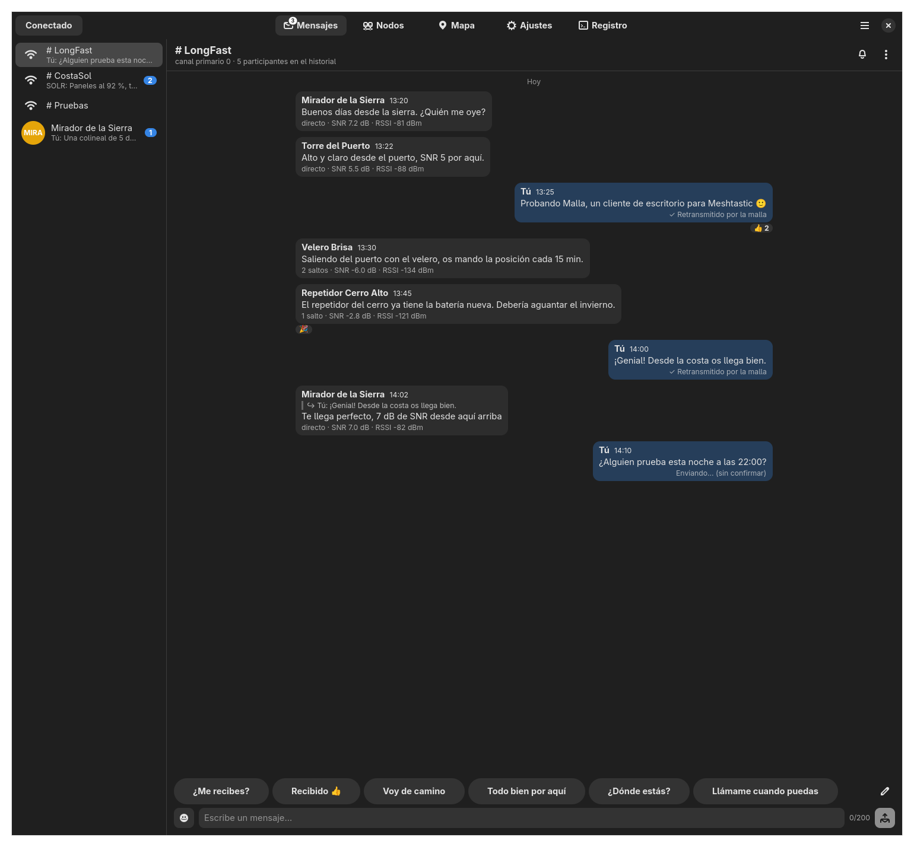
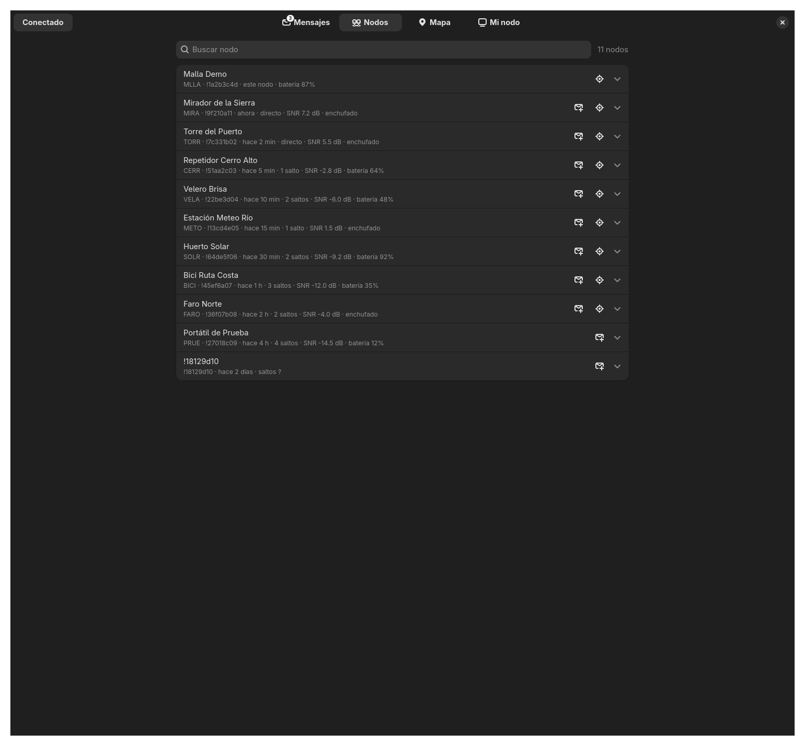
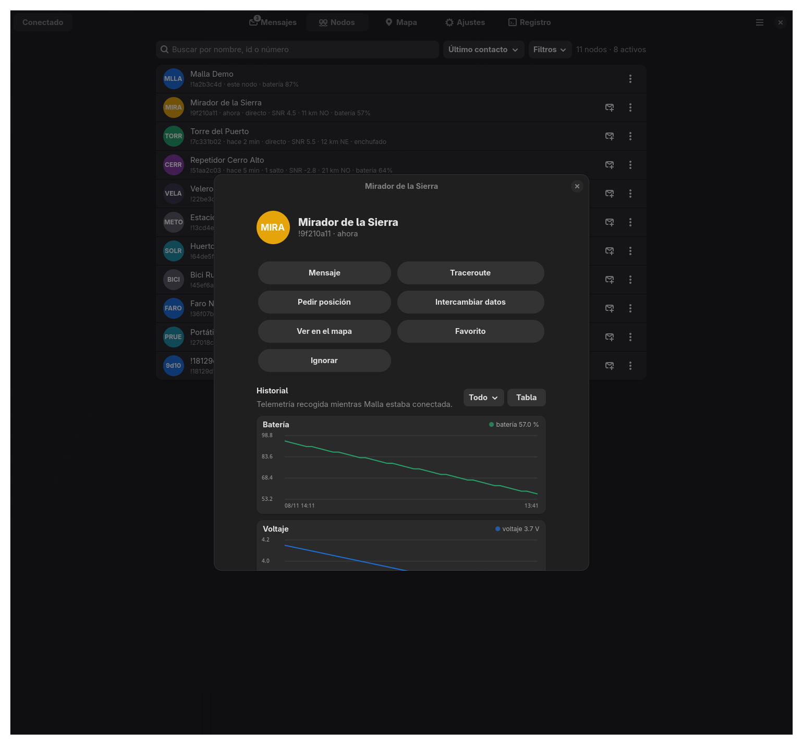
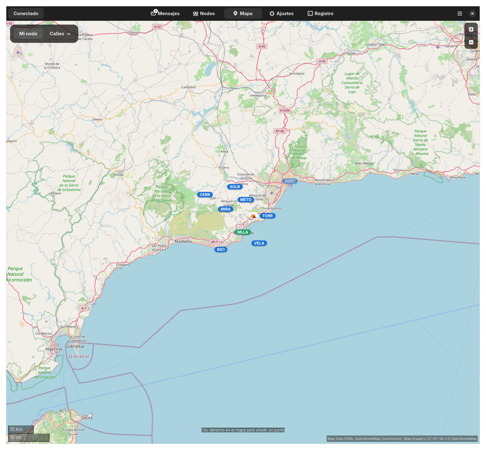
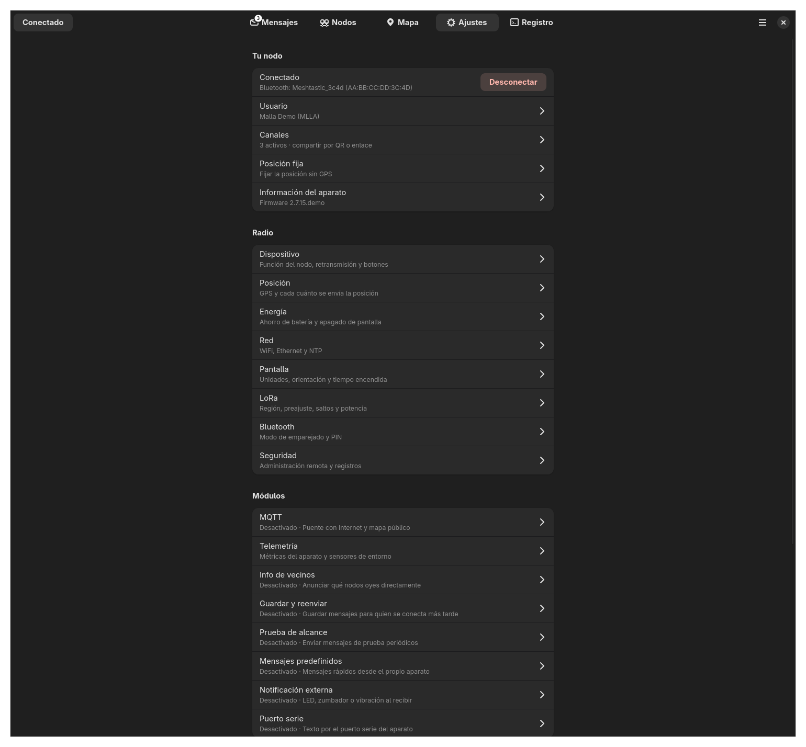
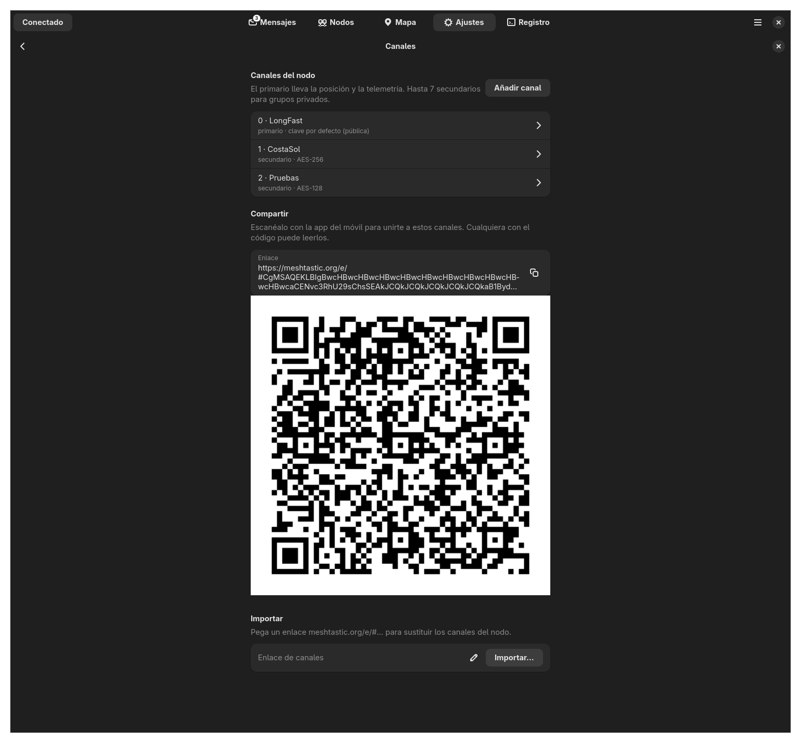
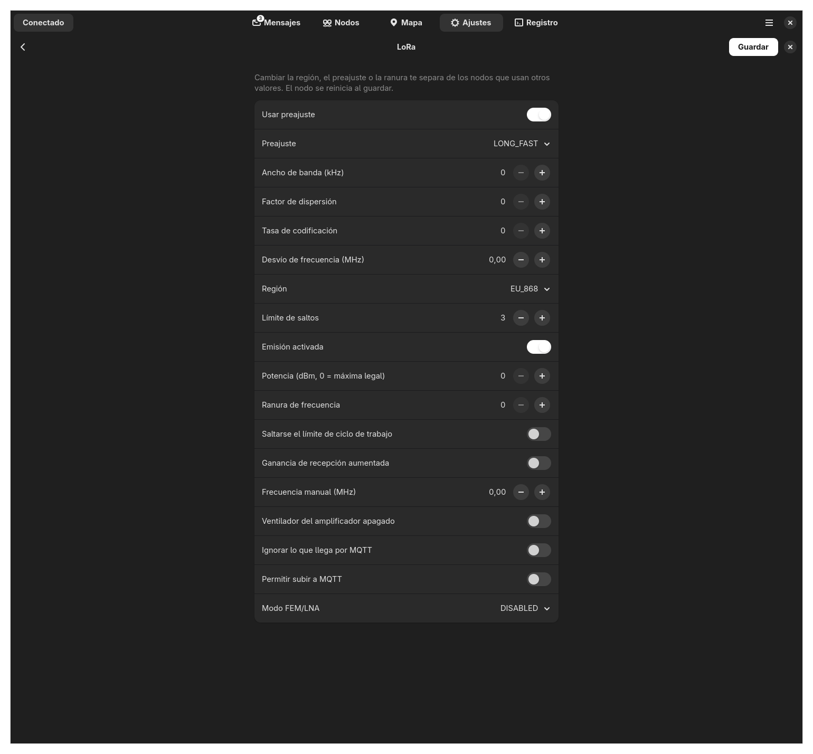
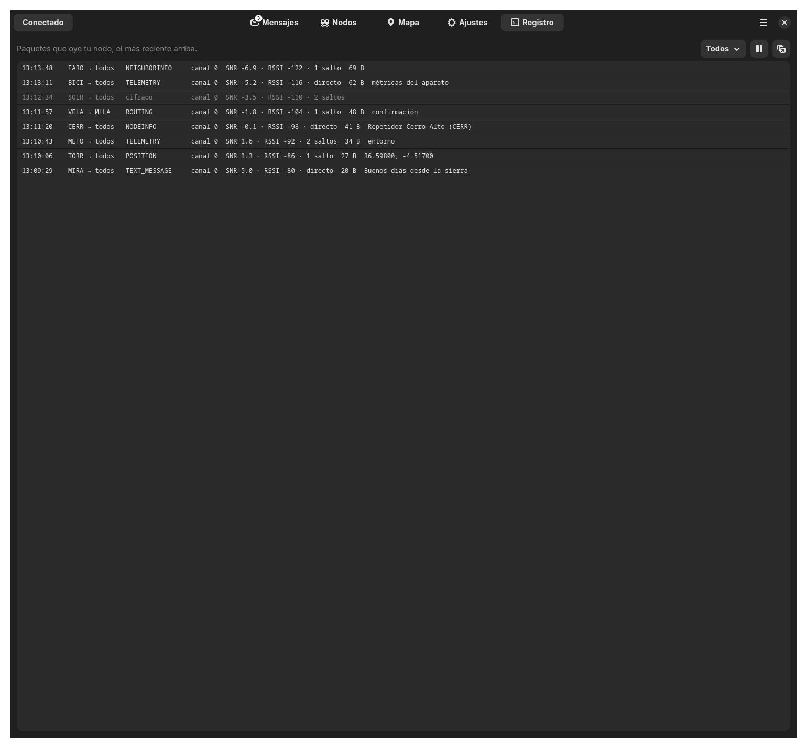
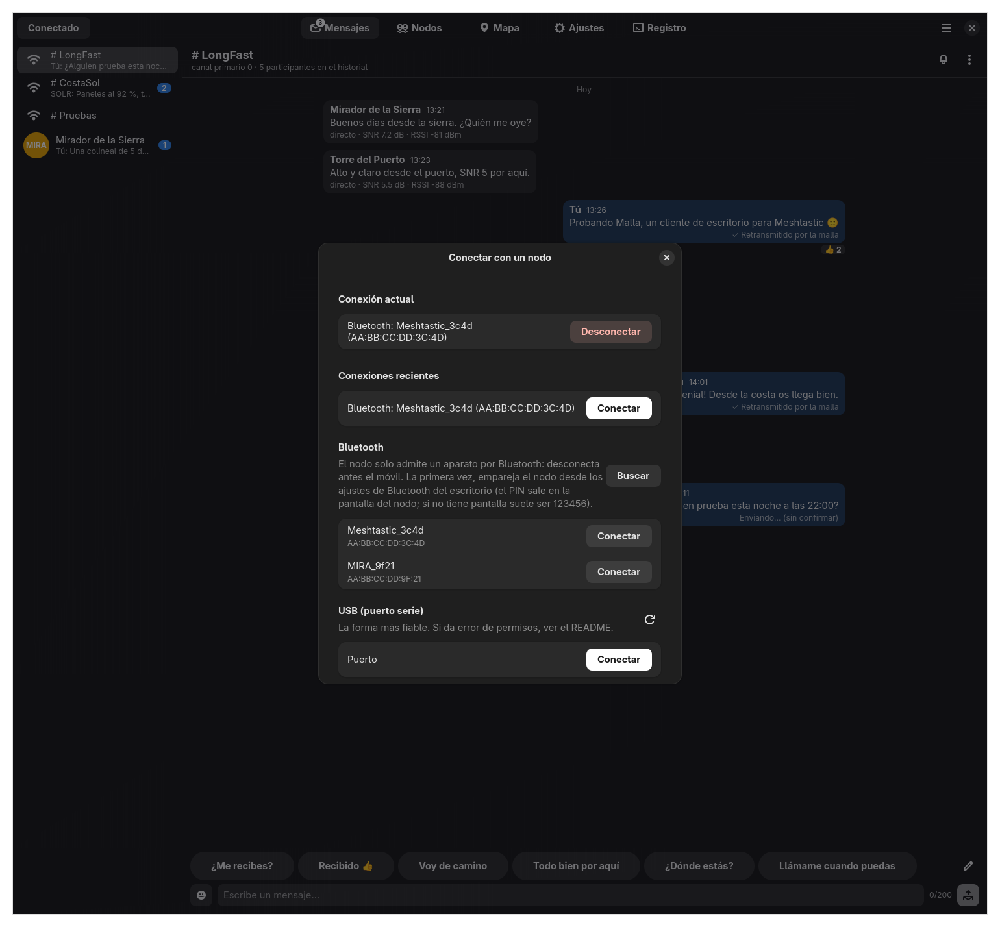
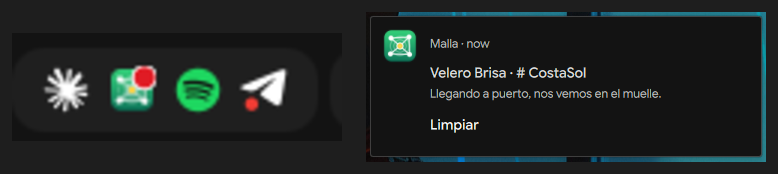

  

<h1 align="center">Malla</h1>

  Cliente de escritorio de <a href="https://meshtastic.org">Meshtastic</a> para Linux. 
  Escrito en Rust con GTK4 y libadwaita.

---

Meshtastic es una red de mensajería por radio LoRa que no necesita Internet ni
cobertura móvil. Hay app oficial para el móvil y un cliente web, pero no una app de
escritorio para Linux. Malla es eso: conecta con tu nodo por Bluetooth, USB o WiFi
y te deja chatear, ver los nodos de la red y verlos en un mapa.

Las secciones siguen las del [cliente web oficial](https://github.com/meshtastic/web).

> Las capturas usan el modo demo (`malla --demo`), con nodos y mensajes inventados.

## Capturas

**Mensajes.** Canales y chats directos. Respuestas, reacciones con emoji,
respuestas rápidas y estado de entrega de cada mensaje.

**Nodos.** Ordenar por último contacto, distancia, nombre, señal o saltos. Filtros,
distancia y rumbo desde tu nodo, y un menú con todas las acciones.

**Ficha de un nodo.** Acciones, gráficas de batería, voltaje, ocupación del aire,
señal y sensores de entorno, datos completos y traceroutes.

**Mapa.** Nodos, puntos compartidos (waypoints) y el rastro de un nodo. Tres tipos
de mapa. Clic derecho para añadir un punto o fijar la posición de tu nodo.

**Ajustes.** Toda la configuración del nodo y de sus módulos, canales,
administración y preferencias de la app.

**Canales.** Editar, añadir y borrar canales. Compartir por QR o enlace e importar.

**Configuración de radio.** Cada sección con sus controles, en castellano.

**Registro.** Los paquetes que oye tu nodo, con filtro por tipo.

**Conectar.** Bluetooth, USB o red.

**Bandeja del sistema y avisos.** Al cerrar la ventana, Malla se queda en la barra
como Telegram o Spotify. Un punto rojo indica mensajes sin leer.

## Lo que hay

**Conexión**
- Bluetooth LE, USB (puerto serie) o red TCP (puerto 4403).
- Vuelve a conectar sola al arrancar y cuando se cae la conexión (por ejemplo,
  tras reiniciar el nodo).

**Mensajes**
- Todos los canales del nodo y chats directos con cualquier nodo.
- Responder a un mensaje y reaccionar con emoji, como en la app de Android.
- Menú de cada mensaje (clic derecho): responder, reaccionar, copiar, reenviar si
  falló, escribir al autor, ver su ficha y borrar.
- Estado de entrega: enviando, retransmitido por la malla, entregado o el error.
- Respuestas rápidas editables y selector de emoji.
- Separadores por día, contador de no leídos y vista previa del último mensaje.
- Silenciar una conversación, marcarla como leída o borrarla.
- Exportar todos los mensajes a CSV.

**Nodos**
- Ordenar y filtrar: solo activos, sin MQTT, solo favoritos, mostrar ignorados.
- Distancia y rumbo desde tu nodo.
- Traceroute con la ruta de ida y vuelta y la SNR de cada salto.
- Pedir posición e intercambiar datos de usuario.
- Favoritos, ignorar y quitar de la lista del nodo.
- Ficha con gráficas de la telemetría que Malla va guardando.

**Mapa**
- OpenStreetMap: calles, topográfico o humanitario.
- Puntos compartidos (waypoints): recibir, crear, editar y borrar, con icono,
  descripción y caducidad.
- Rastro de las posiciones de un nodo.
- Fijar la posición de tu nodo con clic derecho.

**Ajustes del nodo**
- Usuario: nombre largo, corto y modo radioaficionado.
- Canales: editar nombre, clave (por defecto, aleatoria AES-256, sin cifrado o
  propia), MQTT y precisión de la posición. Añadir, borrar, compartir por QR o
  enlace e importar un enlace.
- Radio: dispositivo, posición, energía, red, pantalla, LoRa, Bluetooth y seguridad.
- Módulos: MQTT, telemetría, info de vecinos, guardar y reenviar, prueba de
  alcance, mensajes predefinidos, notificación externa, puerto serie, audio,
  hardware remoto, iluminación, sensor de detección, contador de personas y más.
- Posición fija.
- Administración: reiniciar, apagar, borrar la lista de nodos y restablecer.
- Información del aparato: firmware y capacidades.

**La app**
- Icono en la bandeja del sistema con aviso de no leídos.
- Avisos de escritorio; al pulsarlos se abre esa conversación.
- Abrir al iniciar la sesión, arrancar escondida, tema claro u oscuro.
- Registro de paquetes con filtro y pausa.
- Modo demo (`malla --demo`) para probar sin radio.

## Lo que falta

- Probar a fondo los ajustes del nodo con hardware real. La versión 0.2 se ha usado
  con un Heltec V3 por Bluetooth, pero no se han guardado todas las secciones de
  configuración en un nodo de verdad.
- Mapa sin conexión (guardar teselas).
- Administrar otros nodos a distancia.
- Pedir al nodo los mensajes guardados (cliente de "guardar y reenviar").
- Gráfica de vecinos y resultados de la prueba de alcance en el mapa.
- Enviar la posición del ordenador (GPS o ubicación del sistema).
- Copia de seguridad completa de la configuración y actualizar el firmware.
- Verificación de claves entre nodos.
- Otros idiomas. La interfaz solo está en español.
- Flatpak.

Los cambios de cada versión están en el [historial](CHANGELOG.md).

Si encuentras un fallo, cuéntalo en una [incidencia](https://github.com/FreeMEM/malla/issues).

## Instalar

### Ubuntu 24.04 o posterior (y Debian 13)

Descarga el `.deb` de la [última versión](https://github.com/FreeMEM/malla/releases/latest) e instálalo:

    sudo apt install ./malla_*_amd64.deb

### Arch Linux, CachyOS, Manjaro

Paquete ya compilado, de la [última versión](https://github.com/FreeMEM/malla/releases/latest):

    sudo pacman -U https://github.com/FreeMEM/malla/releases/download/v0.2.0/malla-0.2.0-1-x86_64.pkg.tar.zst

O compilándolo tú con el PKGBUILD:

    git clone https://github.com/FreeMEM/malla
    cd malla/empaquetar/aur && makepkg -si

Llegará a AUR cuando reabran el registro de cuentas.

### Desde el código

Necesitas Rust 1.85 o posterior y las cabeceras de GTK 4.12+, libadwaita 1.5+,
libshumate 1.1+ y D-Bus. En Ubuntu, el Rust de los repositorios es antiguo: instálalo
con [rustup](https://rustup.rs).

    # Arch
    sudo pacman -S --needed rust gtk4 libadwaita libshumate dbus
    # Ubuntu / Debian (más rustup)
    sudo apt install build-essential pkg-config libgtk-4-dev libadwaita-1-dev libshumate-dev libdbus-1-dev

    cargo build --release
    ./instalar.sh      # programa, icono y lanzador en ~/.local

## Uso

Abre Malla y pulsa **Conectar**.

- **Bluetooth.** El nodo solo acepta un aparato a la vez: desconecta antes el móvil.
  La primera vez, empareja el nodo desde los ajustes de Bluetooth del escritorio.
  El PIN sale en la pantalla del nodo; si no tiene pantalla suele ser `123456`.
- **USB.** La forma más fiable. Tu usuario necesita permiso sobre el puerto:
  - Arch: `sudo usermod -aG uucp $USER`
  - Ubuntu y Debian: `sudo usermod -aG dialout $USER`

  Después, cierra la sesión y vuelve a entrar.
- **Red.** Solo si el nodo tiene la WiFi o Ethernet activada. Escribe su IP.

Opciones de línea de órdenes:

| Opción | Qué hace |
|---|---|
| `--demo` | Abre con datos inventados, sin radio y sin guardar nada. |
| `--escanear` | Lista los nodos por Bluetooth y los puertos serie, sin ventana. |
| `--probar <MAC>` | Conecta por Bluetooth, resume lo recibido y sale. |
| `--oculta` | Arranca escondida en la bandeja. |
| `--pagina <nombre>` | Abre en `mensajes`, `nodos`, `mapa`, `ajustes`, `registro`, `conectar`, `ficha:<id>` o `ajustes:<sección>`. |

## Empaquetado

- `empaquetar/deb.sh` crea el `.deb` en un contenedor de Ubuntu 24.04 (podman o docker).
- `empaquetar/arch.sh` crea el paquete de Arch en un contenedor Arch limpio.
- `empaquetar/aur/` tiene el `PKGBUILD` de AUR y `publicar.sh`, que lo sube.

## Gracias a

- [meshtastic/rust](https://github.com/meshtastic/rust), la librería que habla con el nodo.
- [meshtastic/web](https://github.com/meshtastic/web), el modelo para las secciones.
- [libshumate](https://gitlab.gnome.org/GNOME/libshumate) y los colaboradores de
  [OpenStreetMap](https://www.openstreetmap.org/copyright) por el mapa.
- [ksni](https://github.com/iovxw/ksni) por el icono de bandeja.

## Licencia

[GPL-3.0](LICENSE). Malla no es un proyecto oficial de Meshtastic.
Meshtastic® es una marca registrada de Meshtastic LLC.
