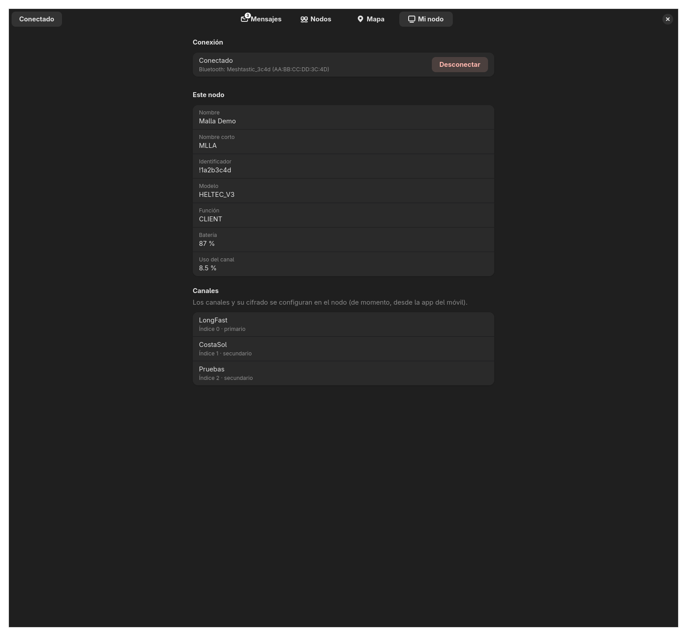

  

<h1 align="center">Malla</h1>

  Cliente de escritorio de <a href="https://meshtastic.org">Meshtastic</a> para Linux. 
  Escrito en Rust con GTK4 y libadwaita.

---

Meshtastic es una red de mensajería por radio LoRa que no necesita Internet ni
cobertura móvil. Hay app oficial para el móvil y un cliente web, pero no una app de
escritorio para Linux. Malla es eso: conecta con tu nodo por Bluetooth, USB o WiFi
y te deja chatear, ver los nodos de la red y verlos en un mapa.

Las secciones siguen las del [cliente web oficial](https://github.com/meshtastic/web).

> Las capturas usan el modo demo (`malla --demo`), con nodos y mensajes inventados.

## Capturas

**Mensajes.** Canales y chats directos, con el estado de cada mensaje enviado.

**Nodos.** Todos los nodos que conoce tu radio, con señal, saltos y batería.

**Mapa.** Los nodos que comparten su posición, sobre OpenStreetMap.

**Mi nodo.** Tu nodo, la conexión y los canales.

**Conectar.** Bluetooth, USB o red.

**Bandeja del sistema y avisos.** Al cerrar la ventana, Malla se queda en la barra
como Telegram o Spotify. Un punto rojo indica mensajes sin leer.

## Lo que hay

- **Conexión** por Bluetooth LE, USB (puerto serie) o red TCP (puerto 4403).
  Vuelve a conectar sola con la última conexión al arrancar.
- **Mensajes** en todos los canales del nodo y chats directos con cualquier nodo.
  - Estado de entrega: enviando, retransmitido por la malla, entregado o el error concreto.
  - En los recibidos: saltos, SNR y RSSI.
  - Contador de no leídos por conversación.
  - Límite de 200 bytes por mensaje, como el cliente oficial.
- **Nodos**: nombre, identificador, último contacto, saltos o MQTT, SNR, RSSI,
  batería, voltaje, uso del canal, tiempo encendido, modelo, función, posición y si
  admite cifrado directo. Con buscador.
- **Mapa** con OpenStreetMap. Tu nodo en verde; los que no se oyen hace más de dos
  horas, atenuados. Pulsa un nodo para ver su ficha y escribirle.
- **Mi nodo**: datos del nodo conectado y lista de canales.
- **Bandeja del sistema** (StatusNotifierItem): mostrar u ocultar, conectar o
  desconectar, salir. Punto rojo con mensajes sin leer.
- **Avisos de escritorio** cuando llega un mensaje y la ventana no está delante.
- **Historial** guardado en `~/.local/share/malla/estado.json` (últimos 5000 mensajes).
- **Modo demo** (`malla --demo`) para probar la interfaz sin radio.

## Lo que falta

- **Configurar el nodo.** Ahora todo es de solo lectura: radio, canales, posición,
  módulos y usuario se cambian desde la app del móvil. Es lo siguiente en la lista.
- Responder a un mensaje concreto y reacciones con emoji.
- Traceroute y pedir posición o datos a un nodo.
- Waypoints (puntos marcados en el mapa).
- Telemetría de entorno (temperatura, humedad…) y gráficas.
- Rutas y rastros en el mapa.
- Compartir canales por QR o URL. Copia de seguridad de la configuración.
- Silenciar avisos por canal.
- Otros idiomas. La interfaz solo está en español.
- Flatpak.

Probado con un Heltec V3 por Bluetooth. USB y WiFi están hechos pero no se han
probado aún con hardware real. Si los pruebas, cuenta cómo te ha ido en una
[incidencia](https://github.com/FreeMEM/malla/issues).

## Instalar

### Ubuntu 24.04 o posterior (y Debian 13)

Descarga el `.deb` de la [última versión](https://github.com/FreeMEM/malla/releases/latest) e instálalo:

    sudo apt install ./malla_*_amd64.deb

### Arch Linux, CachyOS, Manjaro

Paquete ya compilado, de la [última versión](https://github.com/FreeMEM/malla/releases/latest):

    sudo pacman -U https://github.com/FreeMEM/malla/releases/download/v0.1.0/malla-0.1.0-1-x86_64.pkg.tar.zst

O compilándolo tú con el PKGBUILD:

    git clone https://github.com/FreeMEM/malla
    cd malla/empaquetar/aur && makepkg -si

Llegará a AUR cuando reabran el registro de cuentas.

### Desde el código

Necesitas Rust 1.85 o posterior y las cabeceras de GTK 4.12+, libadwaita 1.5+,
libshumate 1.1+ y D-Bus. En Ubuntu, el Rust de los repositorios es antiguo: instálalo
con [rustup](https://rustup.rs).

    # Arch
    sudo pacman -S --needed rust gtk4 libadwaita libshumate dbus
    # Ubuntu / Debian (más rustup)
    sudo apt install build-essential pkg-config libgtk-4-dev libadwaita-1-dev libshumate-dev libdbus-1-dev

    cargo build --release
    ./instalar.sh      # programa, icono y lanzador en ~/.local

## Uso

Abre Malla y pulsa **Conectar**.

- **Bluetooth.** El nodo solo acepta un aparato a la vez: desconecta antes el móvil.
  La primera vez, empareja el nodo desde los ajustes de Bluetooth del escritorio.
  El PIN sale en la pantalla del nodo; si no tiene pantalla suele ser `123456`.
- **USB.** La forma más fiable. Tu usuario necesita permiso sobre el puerto:
  - Arch: `sudo usermod -aG uucp $USER`
  - Ubuntu y Debian: `sudo usermod -aG dialout $USER`

  Después, cierra la sesión y vuelve a entrar.
- **Red.** Solo si el nodo tiene la WiFi o Ethernet activada. Escribe su IP.

Opciones de línea de órdenes:

| Opción | Qué hace |
|---|---|
| `--demo` | Abre con datos inventados, sin radio y sin guardar nada. |
| `--escanear` | Lista los nodos por Bluetooth y los puertos serie, sin ventana. |
| `--probar <MAC>` | Conecta por Bluetooth, resume lo recibido y sale. |
| `--pagina <nombre>` | Abre en `mensajes`, `nodos`, `mapa`, `yo` o `conectar`. |

## Empaquetado

- `empaquetar/deb.sh` crea el `.deb` en un contenedor de Ubuntu 24.04 (podman o docker).
- `empaquetar/arch.sh` crea el paquete de Arch en un contenedor Arch limpio.
- `empaquetar/aur/` tiene el `PKGBUILD` de AUR y `publicar.sh`, que lo sube.

## Gracias a

- [meshtastic/rust](https://github.com/meshtastic/rust), la librería que habla con el nodo.
- [meshtastic/web](https://github.com/meshtastic/web), el modelo para las secciones.
- [libshumate](https://gitlab.gnome.org/GNOME/libshumate) y los colaboradores de
  [OpenStreetMap](https://www.openstreetmap.org/copyright) por el mapa.
- [ksni](https://github.com/iovxw/ksni) por el icono de bandeja.

## Licencia

[GPL-3.0](LICENSE). Malla no es un proyecto oficial de Meshtastic.
Meshtastic® es una marca registrada de Meshtastic LLC.
